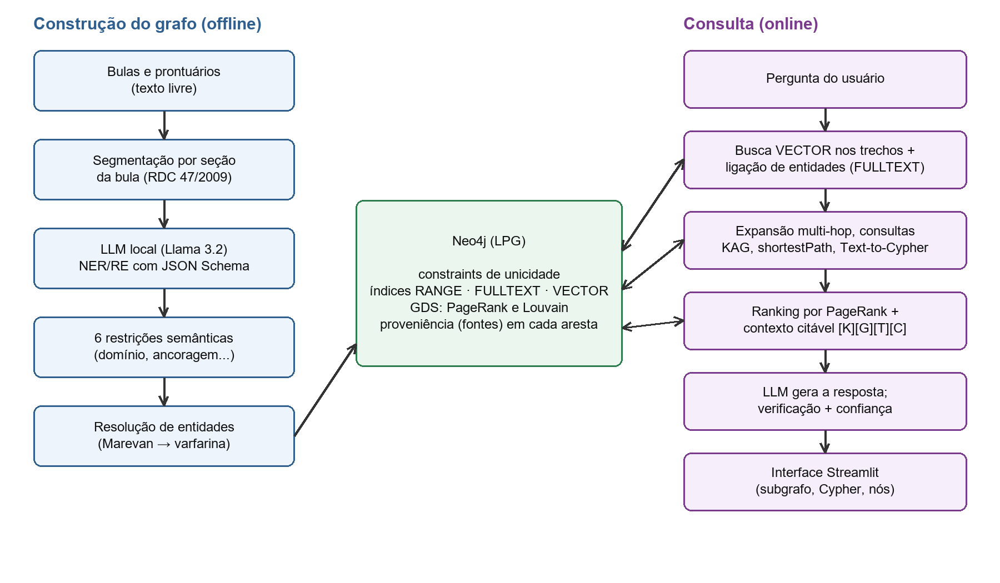

# FarmaGraph RAG: Recuperação Aumentada por Grafos de Conhecimento para Interações Medicamentosas com LLM Local

**Biel Aguiar, Thiago Rocha**  
Curso de Bacharelado em Ciência da Computação – Unipê Cruzeiro do Sul  


> **Abstract.** *Large language models (LLMs) hallucinate and struggle with questions that require chaining facts from different sources, which is critical in healthcare. This paper presents FarmaGraph RAG, a question answering system about drugs that combines vector search and traversal of a Neo4j knowledge graph (GraphRAG) with logical queries over the graph (KAG). The graph is built from 22 simplified drug leaflets and 7 fictitious medical records by a local LLM (Llama 3.2, 3B) using structured output, section-guided extraction, six semantic constraints and entity resolution. Retrieval uses VECTOR, FULLTEXT and RANGE indexes, multi-hop expansion, shortest paths, PageRank and LLM-generated Cypher validated as read-only. Extraction reached 0.99 precision and 0.85 recall against 168 reference facts, and GraphRAG covered 94.0% of the expected facts in 9 multi-hop questions, versus 17.0% for vector-only RAG and 15.0% for the LLM without context.*

> **Resumo.** *Modelos de linguagem de grande porte (LLMs) alucinam e têm dificuldade com perguntas que exigem encadear fatos de fontes diferentes, o que é crítico em saúde. Este artigo apresenta o FarmaGraph RAG, um sistema de perguntas e respostas sobre medicamentos que combina busca vetorial e travessia de um grafo de conhecimento no Neo4j (GraphRAG) com consultas lógicas sobre o grafo (KAG). O grafo é construído a partir de 22 bulas simplificadas e 7 prontuários fictícios por um LLM local (Llama 3.2, 3B) com saída estruturada, extração guiada pelas seções da bula, seis restrições semânticas e resolução de entidades. A recuperação usa índices VECTOR, FULLTEXT e RANGE, expansão multi-hop, caminhos mínimos, PageRank e Cypher gerado pelo LLM com validação de somente leitura. A extração atingiu precisão de 0,99 e recall de 0,85 frente a um gabarito de 168 fatos, e o GraphRAG cobriu 94,0% dos fatos esperados em 9 perguntas multi-hop, contra 17,0% do RAG apenas vetorial e 15,0% do LLM sem contexto.*

## 1. Introdução

Modelos de linguagem de grande porte (LLMs) produzem textos fluentes, mas podem gerar afirmações sem respaldo nos dados, fenômeno conhecido como alucinação [Ji et al. 2023]. A geração aumentada por recuperação (RAG) reduz o problema ao fornecer ao modelo trechos recuperados por similaridade semântica [Lewis et al. 2020]. A similaridade vetorial, porém, devolve trechos isolados: ela não encadeia fatos que estão espalhados em documentos diferentes, o que limita perguntas *multi-hop*.

Na área da saúde essa limitação é perigosa. Considere a pergunta "A Maria José pode tomar ibuprofeno para a dor no joelho?". A resposta correta exige três passos: (i) o prontuário informa que a paciente usa *Marevan*; (ii) Marevan é um nome comercial da **varfarina**; (iii) a bula da varfarina informa que a associação com ibuprofeno aumenta o risco de sangramento. Um LLM sozinho não conhece o prontuário; um RAG vetorial encontra a bula do ibuprofeno, mas não sabe que a paciente usa varfarina.

Grafos de conhecimento representam entidades e relações de forma explícita e permitem percorrer esses encadeamentos [Hogan et al. 2021; Pan et al. 2024]. Abordagens recentes como o GraphRAG [Edge et al. 2024] e o KAG [Liang et al. 2024] usam o grafo como memória estruturada do LLM. Este trabalho apresenta o **FarmaGraph RAG**, um sistema de perguntas e respostas sobre medicamentos e interações medicamentosas construído sobre o Neo4j. As contribuições são:

- um pipeline *Text-to-Graph* que extrai entidades e relações de bulas e prontuários com um LLM local, guiado pelas seções da bula e filtrado por seis restrições semânticas, com resolução de entidades e proveniência;
- um modelo de grafo de propriedades rotulado (LPG) com constraints de unicidade e índices RANGE, FULLTEXT e VECTOR;
- uma recuperação híbrida que combina busca vetorial, ligação de entidades, travessia de 1 a N saltos, consultas lógicas no estilo KAG, caminhos mínimos, PageRank, Louvain e Cypher gerado pelo LLM com validação de somente leitura;
- uma interface explicável que mostra o subgrafo consultado, as consultas Cypher executadas e um nível de confiança; e
- uma avaliação que compara o LLM sem contexto, o RAG apenas vetorial e o GraphRAG.

Todo o processamento é local (Ollama), sem envio de dados a terceiros, o que é relevante para dados de saúde sob a LGPD [Brasil 2018]. O restante do artigo apresenta a fundamentação (Seção 2), os dados (Seção 3), a arquitetura (Seção 4), a avaliação (Seção 5), as limitações (Seção 6) e a conclusão (Seção 7).

## 2. Fundamentação e Trabalhos Relacionados

**RAG e alucinação.** O RAG [Lewis et al. 2020] combina um recuperador denso com um gerador: os trechos mais similares à pergunta são inseridos no *prompt*. A recuperação depende de *embeddings*; aqui usamos o nomic-embed-text [Nussbaum et al. 2024], que gera vetores de 768 dimensões e distingue o texto indexado (*search_document*) da consulta (*search_query*). O levantamento de [Ji et al. 2023] classifica as alucinações em intrínsecas (contradizem a fonte) e extrínsecas (não verificáveis pela fonte); ambas motivam a verificação pós-resposta adotada na Seção 4.4.

**Grafos de conhecimento e LPG.** Em um grafo de propriedades rotulado, nós e relações têm rótulos e propriedades. O Neo4j implementa esse modelo e oferece a linguagem declarativa Cypher, índices RANGE, FULLTEXT (Lucene) e VECTOR, e a biblioteca Graph Data Science (GDS) com algoritmos de grafos [Robinson et al. 2015].

**GraphRAG e KAG.** O GraphRAG da Microsoft [Edge et al. 2024] extrai um grafo de entidades com um LLM, detecta comunidades e resume cada uma para responder perguntas globais. O KAG [Liang et al. 2024] propõe que parte do raciocínio seja feita de forma lógica sobre o grafo, com o LLM verbalizando conclusões verificadas. O levantamento de [Peng et al. 2024] organiza o GraphRAG em indexação, recuperação e geração baseadas em grafo, estrutura que seguimos na Seção 4.

**Algoritmos de grafos.** O PageRank [Page et al. 1999] mede a centralidade de um nó a partir das ligações que recebe; aqui ele prioriza os fatos mais centrais no contexto. O método de Louvain [Blondel et al. 2008] maximiza a modularidade para encontrar comunidades; aqui ele agrupa os medicamentos em "clusters de risco" de interação.

## 3. Domínio e Dados

O corpus tem **22 bulas simplificadas**, escritas para o projeto com as seções definidas pela RDC nº 47/2009 da ANVISA [ANVISA 2009] (classe terapêutica, indicações, contraindicações, interações medicamentosas, reações adversas, posologia), e **7 prontuários ambulatoriais fictícios** em texto livre. Os prontuários citam os medicamentos apenas pelo nome comercial (o que exige resolução de entidades) e nunca mencionam interações (o que exige raciocínio multi-hop). Um vocabulário controlado com princípios ativos, nomes comerciais e sinônimos é usado somente na resolução de entidades e não contém relações.

Um gabarito separado, com **168 fatos de referência** (22 medicamentos, 22 interações com gravidade e 7 pacientes), é usado **apenas na avaliação**. Os documentos são didáticos e não constituem orientação médica.

## 4. Arquitetura

A Figura 1 resume o sistema, dividido em construção do grafo (offline) e consulta (online). O código está organizado em módulos Python (`app/`) e a interface em Streamlit.



*Figura 1. Arquitetura do FarmaGraph RAG.*

### 4.1. Construção do grafo (Text-to-Graph)

**Segmentação.** As bulas são divididas por seção (um trecho por seção, com o título prefixado); outros documentos são divididos por parágrafos em trechos de até 900 caracteres.

**Extração guiada por seção.** Para cada trecho, o Llama 3.2 (3B parâmetros, quantizado em 4 bits) [Grattafiori et al. 2024] é chamado via Ollama com o parâmetro `format` igual a um JSON Schema: a relação é um *enum* restrito e a lista tem no máximo 10 itens. Em bulas, cada seção só pode gerar a relação correspondente (Indicações → TRATA, Contraindicações → CONTRAINDICADO_EM, Interações → INTERAGE_COM, Reações adversas → PODE_CAUSAR, Classe → PERTENCE_A_CLASSE) e seções sem relação de domínio não chamam o LLM. Em prontuários só são permitidas USA e TEM_CONDICAO.

**Restrições semânticas.** Cada relação proposta pelo LLM passa por seis travas: (1) saída estruturada com *enums*; (2) relação compatível com a seção; (3) relação permitida para o tipo de documento; (4) domínio e contradomínio do esquema, com correção automática de direção invertida; (5) ancoragem textual, ou seja, as duas pontas precisam estar escritas no trecho (ou ser o assunto do documento); e (6) em bulas, a relação precisa envolver o medicamento da bula. Em um teste, o modelo copiou "Aldactone" do exemplo do *prompt* para uma bula que não o mencionava, e a ancoragem bloqueou a relação.

Na última execução da ingestão (29 documentos, 10,1 min), o LLM propôs 182 relações; depois de separar as listas, 162 foram aceitas e 23 rejeitadas, e 32 tiveram a direção ou a origem corrigida. Principais motivos de rejeição: entidade não ancorada no texto: 17; relação não permitida para este documento/seção: 3; destino é Medicamento, esperado EfeitoAdverso: 1; destino é Paciente, esperado Condicao: 1.

**Resolução de entidades.** Os nomes são normalizados (caixa, acentos, doses como "5 mg" e artigos) e resolvidos por: dicionário de nomes comerciais e sinônimos (Marevan → varfarina, Klaricid → claritromicina); correspondência por *tokens* para pacientes ("Maria José" → "Maria José Ferreira"); similaridade aproximada (warfarina → varfarina); e singularização de classes terapêuticas. Antes disso, listas que o LLM devolve como uma entidade só são separadas ("dor e febre" → dor, febre), exceto quando a parte seguinte é um adjetivo ("insuficiência renal e hepática"), e qualificadores como "pacientes com histórico de" são removidos. Os nós são gravados com `MERGE` no identificador normalizado, de modo que a mesma entidade vinda de documentos diferentes vira um único nó.

**Proveniência.** Toda relação guarda a lista `fontes` com os identificadores dos trechos de onde foi extraída, e cada trecho aponta para as entidades que menciona (`MENCIONA`), o que permite rastrear qualquer fato até o texto original.

### 4.2. Modelo de grafo no Neo4j

*Tabela 1. Esquema do grafo (LPG).*

| Relação | Origem → Destino | Propriedades |
|---|---|---|
| PERTENCE_A_CLASSE | Medicamento → ClasseTerapeutica | fontes |
| TRATA | Medicamento → Condicao | fontes |
| CONTRAINDICADO_EM | Medicamento → Condicao | fontes |
| PODE_CAUSAR | Medicamento → EfeitoAdverso | fontes |
| INTERAGE_COM | Medicamento — Medicamento (simétrica) | gravidade, efeito, fontes |
| USA | Paciente → Medicamento | fontes |
| TEM_CONDICAO | Paciente → Condicao | fontes |
| TEM_TRECHO / MENCIONA | Documento → Chunk → entidade | texto, embedding (no Chunk) |

O esquema tem 7 constraints de unicidade em `id` (uma por rótulo, cada uma com seu índice RANGE) e 14 índices ao todo (exceto os de *lookup*): RANGE em `Medicamento.nome`, `Paciente.nome`, `Chunk.documento_id` e na propriedade `gravidade` da relação INTERAGE_COM; FULLTEXT `entidade_nome` (nome e nomes comerciais) e `chunk_texto`; e VECTOR `chunk_embedding` (768 dimensões, cosseno). Os *embeddings* são gravados com `db.create.setNodeVectorProperty`.

*Tabela 2. Tamanho do grafo após a ingestão.*

| Elemento | Quantidade |
|---|---|
| Medicamento | 22 |
| ClasseTerapeutica | 16 |
| Condicao | 34 |
| EfeitoAdverso | 18 |
| Paciente | 7 |
| Documento / Chunk | 29 / 183 |
| PERTENCE_A_CLASSE | 18 |
| TRATA | 30 |
| CONTRAINDICADO_EM | 23 |
| PODE_CAUSAR | 25 |
| INTERAGE_COM | 22 |
| USA | 13 |
| TEM_CONDICAO | 12 |
| Total de entidades / relações de domínio | 97 / 143 |

### 4.3. Recuperação híbrida

Para cada pergunta, o recuperador executa os passos abaixo; todas as consultas Cypher executadas ficam visíveis na interface.

- **Busca vetorial:** os 5 trechos mais similares pelo índice VECTOR (`db.index.vector.queryNodes`).
- **Ligação de entidades:** termos da pergunta são resolvidos pelo dicionário e pelo índice FULLTEXT com tolerância a erro de digitação (`warfarina~1`); se nada for encontrado, usam-se as entidades dos trechos recuperados.
- **Expansão multi-hop:** padrão de comprimento variável `(s)-[*1..2]-(n)` a partir das entidades-semente.
- **Raciocínio KAG:** consultas de 2 a 3 saltos que produzem conclusões verificadas: interações entre os medicamentos do paciente e o medicamento perguntado, contraindicações pelas condições do paciente e alternativas que tratam a condição sem interação (Listagem 1).
- **Caminhos mínimos:** `shortestPath` entre pares de entidades da pergunta (ex.: fluoxetina → tramadol ← clonazepam).
- **Ranking:** os fatos são pontuados pelo tipo de relação, por ligarem sementes, por estarem em caminhos, pela gravidade e pelo PageRank dos nós, e os mais bem pontuados entram no contexto.
- **Text-to-Cypher (opcional):** o LLM gera uma consulta a partir do esquema e de exemplos; ela só é executada se passar por uma lista de bloqueio (CREATE, MERGE, DELETE, SET, CALL...) e se o `EXPLAIN` do Neo4j indicar consulta somente de leitura (`query_type = 'r'`). Se for rejeitada, o erro volta ao LLM para uma segunda tentativa, e setas em INTERAGE_COM são removidas, pois a relação é simétrica.

*Listagem 1. Consulta KAG: interações entre os medicamentos em uso pelo paciente e o candidato.*

```cypher
MATCH (p:Paciente)-[:USA]->(m:Medicamento)-[i:INTERAGE_COM]-(c:Medicamento)
WHERE elementId(p) IN $pacientes
  AND (elementId(c) IN $candidatos OR (p)-[:USA]->(c))
RETURN p.nome, m.nome AS em_uso, c.nome AS outro,
       i.gravidade, i.efeito, i.fontes
ORDER BY CASE i.gravidade WHEN 'alta' THEN 0 ELSE 1 END
```

O PageRank é calculado pelo GDS sobre todo o grafo de domínio e o Louvain sobre o subgrafo de INTERAGE_COM. As entidades mais centrais foram: varfarina (3,576), ibuprofeno (3,106), sinvastatina (3,087), ácido acetilsalicílico (2,765), espironolactona (2,729). O Louvain encontrou 6 comunidades, 4 delas com mais de um medicamento, que correspondem a grupos de risco (por exemplo, anticoagulação e sangramento; potássio, rim e lítio; serotonina).

### 4.4. Geração, verificação e confiança

O contexto enviado ao LLM é dividido em seções citáveis: conclusões do raciocínio KAG [K#], caminhos, fatos do grafo [G#], resultados do Text-to-Cypher [C#] e trechos [T#]. O *prompt* exige que cada afirmação cite sua fonte. Nos testes, porém, o modelo de 3B tratava mal o contexto completo: chegava a responder que não havia encontrado a informação com o alerta no contexto, ou "encurtava" um caminho de dois saltos e afirmava uma interação direta inexistente. Por isso adotamos a divisão de trabalho do KAG: quando o grafo produz conclusões (alertas [K#]), o LLM recebe **apenas esses alertas** e a tarefa de redigi-los sem acrescentar nem contradizer nada; o contexto completo é usado só quando não há alerta. Os caminhos de dois ou mais saltos entre medicamentos também viram alertas ("não há relação direta entre fluoxetina e clonazepam; eles se ligam por tramadol"). Se a resposta ainda assim não citar um alerta, a conclusão verificada é inserida no início, identificada como "Conclusão do grafo". Após a geração, um verificador confere se as citações existem e procura, na resposta, medicamentos e condições que não aparecem no contexto (indício de alucinação extrínseca).

A confiança é a média ponderada de quatro sinais: similaridade vetorial do melhor trecho (25%), suporte do grafo, ou seja, se houve alerta KAG ou caminho (25%), fração das entidades da resposta presentes no contexto (35%) e fração de citações válidas (15%). Valores ≥ 0,75 são classificados como Alta, ≥ 0,5 como Média e os demais como Baixa.

### 4.5. Interface

A interface em Streamlit tem cinco abas: **Perguntar** (resposta com citações, subgrafo interativo em pyvis com as sementes em destaque, consultas Cypher executadas, nós consultados, confiança e comparação opcional com o RAG vetorial); **Explorar o grafo** (colorido por rótulo ou por comunidade, ranking de PageRank); **Ingestão** (envio de novos documentos, relações rejeitadas por motivo e tabela de resolução de entidades); **Avaliação**; e **Esquema Neo4j** (constraints e índices).

## 5. Avaliação

Os experimentos rodaram em um notebook com GPU NVIDIA RTX 3050 (4 GB), Neo4j 5.26 Community com APOC e GDS 2.13 em Docker, e Ollama com Llama 3.2 (3B) e nomic-embed-text.

### 5.1. Qualidade da extração

O grafo extraído é comparado ao gabarito após normalização dos nomes (similaridade mínima de 0,85). A Tabela 3 mostra precisão, revocação (*recall*) e F1 por tipo de relação.

*Tabela 3. Extração de relações: grafo extraído × gabarito.*

| Relação | Gabarito | Extraídas | Corretas | Precisão | Recall | F1 |
|---|---|---|---|---|---|---|
| PERTENCE_A_CLASSE | 22 | 18 | 18 | 1,00 | 0,82 | 0,90 |
| TRATA | 38 | 30 | 30 | 1,00 | 0,79 | 0,88 |
| CONTRAINDICADO_EM | 23 | 23 | 23 | 1,00 | 1,00 | 1,00 |
| PODE_CAUSAR | 34 | 25 | 25 | 1,00 | 0,74 | 0,85 |
| INTERAGE_COM | 22 | 22 | 22 | 1,00 | 1,00 | 1,00 |
| USA | 13 | 13 | 13 | 1,00 | 1,00 | 1,00 |
| TEM_CONDICAO | 16 | 12 | 11 | 0,92 | 0,69 | 0,79 |
| TOTAL | 168 | 143 | 142 | 0,99 | 0,85 | 0,91 |

No total, a extração obteve precisão de 0,99, recall de 0,85 e F1 de 0,91, e a gravidade das interações extraídas estava correta em 22/22. As relações de interação, contraindicação e uso de medicamento, que são as que sustentam o raciocínio multi-hop, foram extraídas por completo. Houve 1 relação fora do gabarito (luiza andrade TEM_CONDICAO cefaleia); ao conferir o texto, trata-se de um sintoma realmente escrito no prontuário que o gabarito não lista, ou seja, uma lacuna do gabarito e não uma alucinação. Os fatos não extraídos concentram-se em PODE_CAUSAR (9), TRATA (8), TEM_CONDICAO (5): as restrições preferem descartar a aceitar um fato duvidoso. Outra limitação observada é que o modelo às vezes não separa listas, gerando entidades compostas como "dor e febre" ou "sangramento e úlcera gástrica"; a comparação por similaridade conta essas relações como corretas, mas elas indicam espaço para um passo de normalização de listas.

### 5.2. Perguntas multi-hop

Nove perguntas exigem encadear prontuário, dicionário e bula (Tabela 5). Cada resposta é pontuada pela cobertura: a fração dos fatos esperados (grupos de palavras-chave do gabarito) presentes no texto. Comparamos três modos com o mesmo LLM: sem contexto, RAG apenas vetorial (5 trechos) e o GraphRAG proposto.

*Tabela 4. Resultado por modo de resposta.*

| Modo | Cobertura média | Perguntas 100% | Entidades sem suporte | Tempo médio (s) |
|---|---|---|---|---|
| LLM sem contexto | 15,0% | 1/9 | n/a | 6,8 |
| RAG só vetorial | 17,0% | 0/9 | 5 | 15,6 |
| GraphRAG (este projeto) | 94,0% | 8/9 | 0 | 23,8 |

*Tabela 5. Cobertura por pergunta.*

| Pergunta | LLM | RAG vetorial | GraphRAG |
|---|---|---|---|
| A Maria José pode tomar ibuprofeno para a dor no joelho? | 0,00 | 0,33 | 1,00 |
| Qual o risco de prescrever claritromicina para o José Carlos? | 0,00 | 0,00 | 1,00 |
| A Ana Beatriz pode usar Tramal depois da cirurgia? | 0,00 | 0,00 | 1,00 |
| Por que o potássio do Antônio pode estar alto? | 0,33 | 0,33 | 1,00 |
| Há interações entre os medicamentos do Roberto? | 0,00 | 0,00 | 1,00 |
| Que remédio para febre é seguro para a Luiza, com suspeita de dengue? | 1,00 | 0,50 | 0,50 |
| A Francisca pode começar hidroclorotiazida para a pressão? | 0,00 | 0,00 | 1,00 |
| Quais medicamentos interagem com a varfarina? | 0,00 | 0,33 | 1,00 |
| Como a fluoxetina se relaciona com o clonazepam? | 0,00 | 0,00 | 1,00 |

Em média, o GraphRAG cobriu 94,0% dos fatos esperados em 9 perguntas multi-hop, contra 17,0% do RAG apenas vetorial e 15,0% do LLM sem contexto. O LLM sem contexto não conhece os pacientes e tende a responder de forma genérica; o RAG vetorial recupera a bula certa quando o medicamento é citado, mas não liga o paciente aos medicamentos que ele usa. O GraphRAG resolve o nome comercial, percorre Paciente → Medicamento → Medicamento e entrega ao LLM a conclusão já verificada no grafo. Em 5 das 9 respostas o LLM não citou o alerta por conta própria e a conclusão do grafo foi inserida pelo mecanismo da Seção 4.4. O custo é o tempo: a recuperação híbrida e as consultas Cypher deixam o GraphRAG mais lento que as linhas de base, embora ainda abaixo de meio minuto por pergunta em uma GPU de 4 GB.

## 6. Limitações e Trabalhos Futuros

- O modelo de 3B parâmetros erra parte das extrações; as restrições semânticas trocam revocação por precisão.
- O corpus é pequeno e didático; uma avaliação real exigiria bulas oficiais e um gabarito produzido por farmacêuticos.
- A métrica de cobertura por palavras-chave não mede a qualidade clínica da resposta; métricas como as do RAGAS e avaliação humana seriam o próximo passo.
- O dicionário de nomes comerciais é mantido manualmente; em produção viria de uma base oficial (DCB/ANVISA).
- Trabalhos futuros: modelos maiores, resumos de comunidade (busca global do GraphRAG) e atualização incremental do grafo com novas bulas.

## 7. Conclusão

O FarmaGraph RAG mostra que um grafo de conhecimento construído automaticamente por um LLM pequeno e local, desde que a extração seja guiada pela estrutura do documento e filtrada por restrições semânticas, permite responder perguntas que exigem encadear fatos de documentos diferentes. A combinação de busca vetorial, travessia Cypher, consultas lógicas no estilo KAG e verificação pós-resposta torna cada afirmação rastreável até o trecho de origem. Na avaliação, o GraphRAG cobriu 94,0% dos fatos esperados em 9 perguntas multi-hop, contra 17,0% do RAG apenas vetorial e 15,0% do LLM sem contexto. O código, os dados e as instruções de reprodução estão no repositório do projeto.

## Referências

- ANVISA (2009). Resolução RDC nº 47, de 8 de setembro de 2009. Estabelece regras para elaboração, harmonização, atualização, publicação e disponibilização de bulas de medicamentos. Diário Oficial da União.
- Blondel, V. D., Guillaume, J.-L., Lambiotte, R. e Lefebvre, E. (2008). Fast unfolding of communities in large networks. Journal of Statistical Mechanics: Theory and Experiment, 2008(10):P10008.
- Brasil (2018). Lei nº 13.709, de 14 de agosto de 2018. Lei Geral de Proteção de Dados Pessoais (LGPD).
- Edge, D., Trinh, H., Cheng, N., Bradley, J., Chao, A., Mody, A., Truitt, S. e Larson, J. (2024). From local to global: a Graph RAG approach to query-focused summarization. arXiv:2404.16130.
- Grattafiori, A. et al. (2024). The Llama 3 herd of models. arXiv:2407.21783.
- Hogan, A. et al. (2021). Knowledge graphs. ACM Computing Surveys, 54(4):1–37.
- Ji, Z., Lee, N., Frieske, R., Yu, T., Su, D., Xu, Y., Ishii, E., Bang, Y. J., Madotto, A. e Fung, P. (2023). Survey of hallucination in natural language generation. ACM Computing Surveys, 55(12):1–38.
- Lewis, P. et al. (2020). Retrieval-augmented generation for knowledge-intensive NLP tasks. In Advances in Neural Information Processing Systems 33 (NeurIPS 2020), p. 9459–9474.
- Liang, L. et al. (2024). KAG: boosting LLMs in professional domains via knowledge augmented generation. arXiv:2409.13731.
- Nussbaum, Z., Morris, J. X., Duderstadt, B. e Mulyar, A. (2024). Nomic Embed: training a reproducible long context text embedder. arXiv:2402.01613.
- Page, L., Brin, S., Motwani, R. e Winograd, T. (1999). The PageRank citation ranking: bringing order to the web. Relatório técnico, Stanford InfoLab.
- Pan, S., Luo, L., Wang, Y., Chen, C., Wang, J. e Wu, X. (2024). Unifying large language models and knowledge graphs: a roadmap. IEEE Transactions on Knowledge and Data Engineering, 36(7):3580–3599.
- Peng, B. et al. (2024). Graph retrieval-augmented generation: a survey. arXiv:2408.08921.
- Robinson, I., Webber, J. e Eifrem, E. (2015). Graph Databases: New Opportunities for Connected Data. 2ª ed. O'Reilly Media.